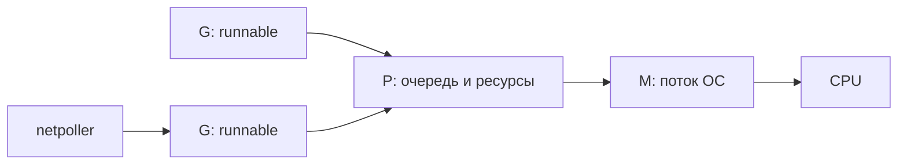

# Go scheduler: GMP, netpoller, preemption, fairness и поведение под нагрузкой

## 1. G, M, P — не синонимы

**G** — горутина (состояние, стек, информация планировщику); **M** — поток ОС; **P** — контекст, необходимый потоку для исполнения Go-кода, с локальной очередью runnable задач и ресурсами исполнения. `GOMAXPROCS` определяет число P, а не максимальное число горутин, M или TCP-соединений.

Это **схема принципа**, а не неизменный layout структур runtime.

## 2. Локальные и глобальные очереди, work stealing

Планировщик обычно использует локальные очереди на P и глобальные механизмы балансировки. Свободный P может забирать работу у других. Из этого следуют два вывода: порядок запуска не определён, а размещение горутин по потокам непостоянно.

**Нельзя** строить семантику приложения на «горутина A запустилась раньше B, значит A выполнится первой». Даже `GOMAXPROCS(1)` не гарантирует простого FIFO.

## 3. Что происходит при блокировке

Ожидание на канале, `sync.Mutex`, таймере обычно паркует G и позволяет P выполнять другие задачи. На настоящем блокирующем syscall M может остаться в ядре; runtime может отдать P другому M. Поэтому тысяча горутин ≠ тысяча потоков ОС, но крайне много системных вызовов, заблокировавших M, всё же дорого.

## 4. Netpoller

Для обычного сетевого I/O Go использует механизм уведомлений ОС о готовности сокетов (epoll/kqueue/IOCP и т. п., в зависимости от платформы). Горутина может ждать сети, не закрепляя за собой отдельный поток ОС. Но соединение и его буферы, stack, fd, request context — реальные ресурсы, поэтому ограничения и deadlines нужны.

## 5. Preemption

Старая модель «горутина уступает CPU только на вызове функции» устарела: современный runtime умеет асинхронное вытеснение в поддерживаемых точках. Тем не менее нет гарантии, что строго любая горутина исполняется за N наносекунд. Длинные CPU-bound участки, cgo и конкуренция за P влияют на задержки.

**Каверза:** вместо синхронизации программисты иногда вставляют `runtime.Gosched()` или `time.Sleep`. Это не создаёт happens-before и не исправляет data race.

## 6. `GOMAXPROCS` и реальная параллельность

Если `GOMAXPROCS=1`, в каждый момент времени для пользовательского Go-кода доступен один P, но другие горутины могут чередоваться, а некоторые системные/cgo-операции идут вне обычного выполнения Go. Увеличение числа P не ускоряет автоматически сервис: contention, GC, cache misses, memory bandwidth могут ограничить throughput.

## 7. Контейнеры и CPU quotas

Современный runtime учитывает доступные CPU и ограничения окружения при выборе стандартного `GOMAXPROCS` (точный алгоритм и обновление значения зависят от версии). Поэтому в контейнере значение не обязательно равно числу всех физических CPU машины. Для тюнинга смотреть фактическое `runtime.GOMAXPROCS(0)`, конфигурацию контейнера и метрики CPU throttling.

## 8. Почему тысячи заблокированных G не бесплатны

Ожидающая G удерживает стек и доступные ей объекты, может удерживать ресурсы и каналы. В процессе, где «каждый запрос породил фонового воркера, который завис», число горутин постепенно растёт — настоящая утечка, даже если CPU почти не используется.

В Go 1.27 `runtime/pprof` предоставляет профиль `goroutineleak` для части гарантированно невозобновимых ожиданий; обычный `goroutine` профиль тоже полезен, но сам по себе не доказывает утечки.

## 9. Практическая диагностика

- `go test -race` — гонки памяти, не deadlock.
- CPU profile — кто использует процессор.
- `block` profile — где ждут синхронизацию.
- `mutex` profile — конкуренция за mutex.
- `runtime/trace` — последовательности парковки/пробуждения/события планировщика.
- Goroutine dump/leak profile — зависшие ожидания и стек вызова.

## 10. Интервью-вопросы

Почему рост `GOMAXPROCS` может ухудшить latency? Чем netpoller отличается от отдельного M на каждый сокет? Почему вызов `Sleep` не исправляет гонку? Почему заблокированная горутина потребляет память, хотя не использует CPU?

Источники: [runtime/HACKING](https://go.dev/src/runtime/HACKING), [runtime](https://pkg.go.dev/runtime), [Go 1.27 release notes](https://go.dev/doc/go1.27).